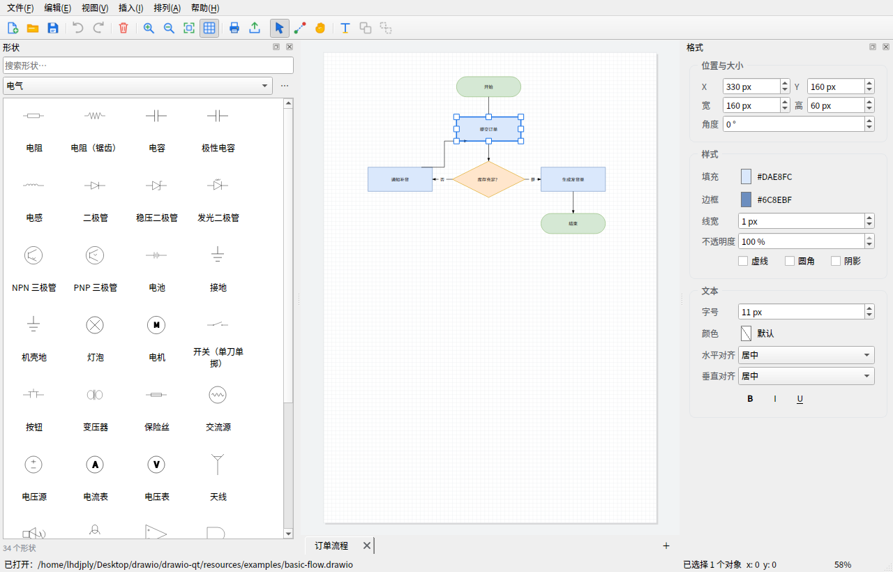
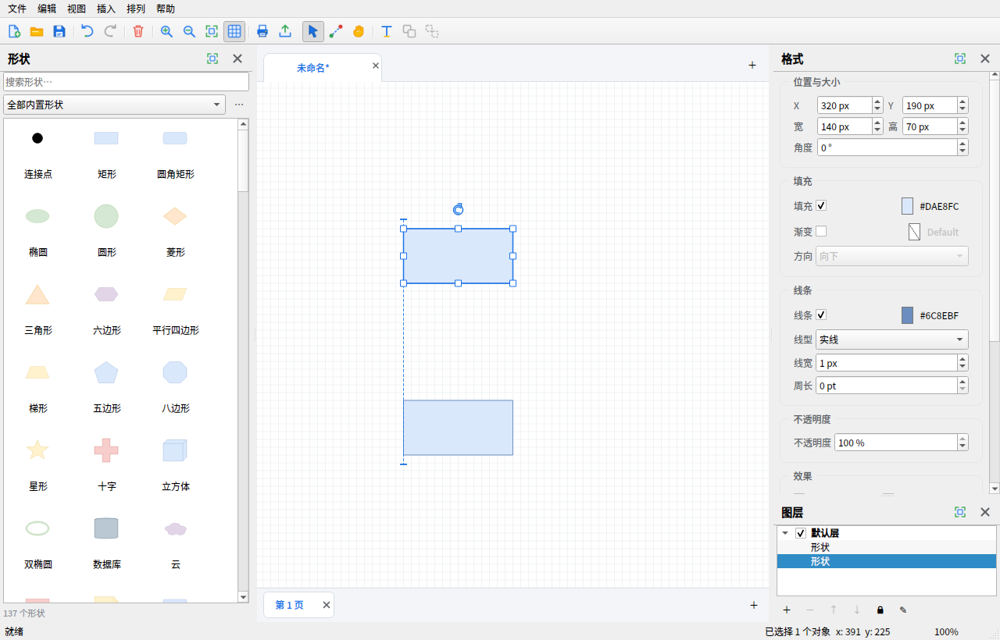
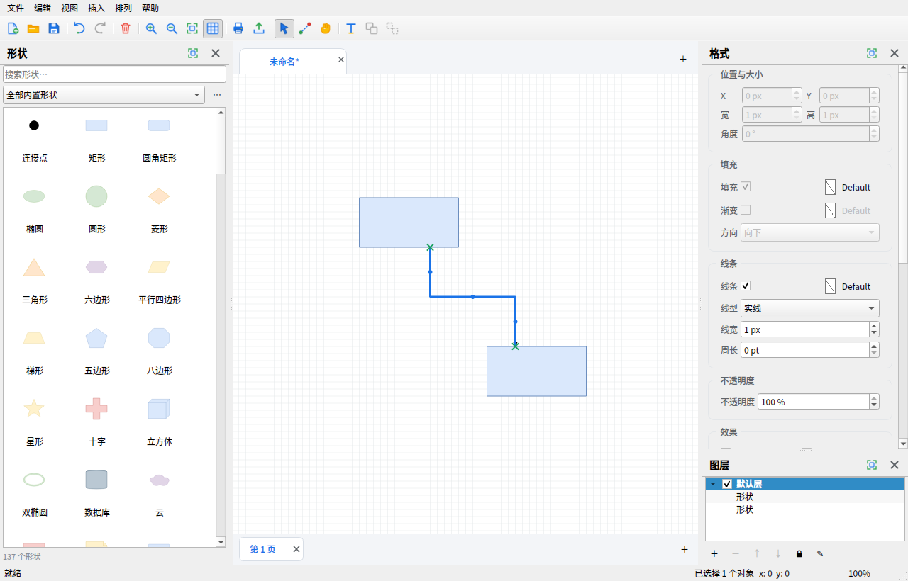
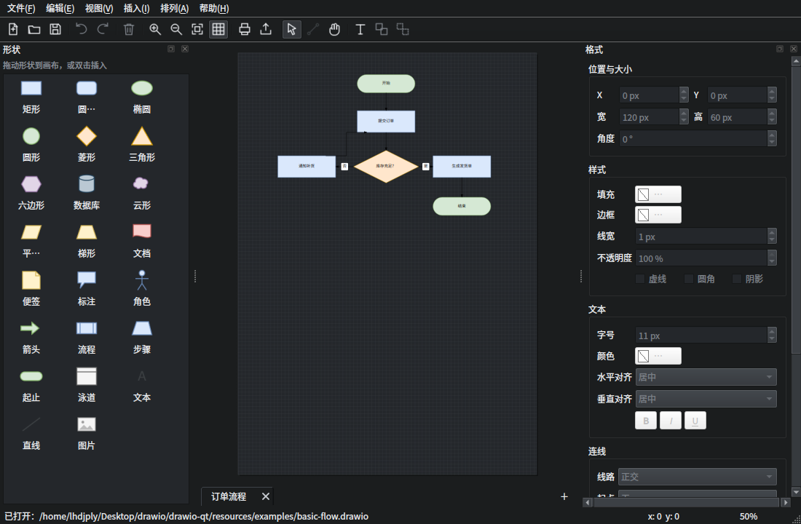
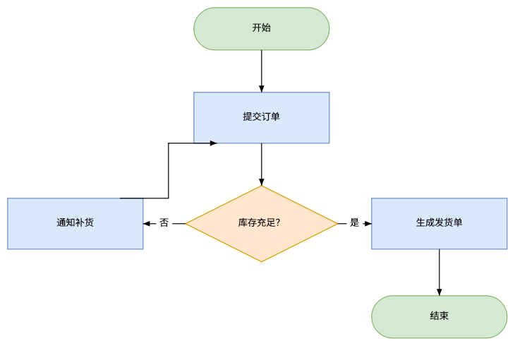
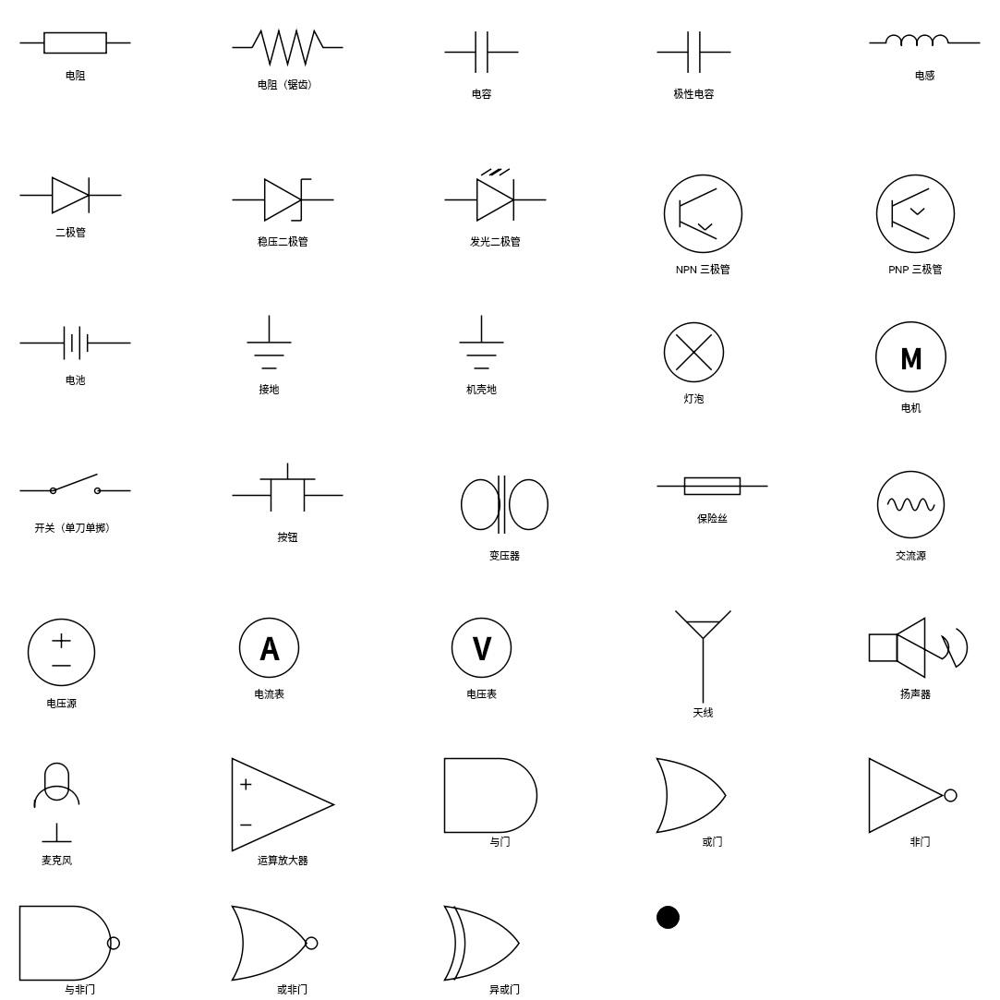
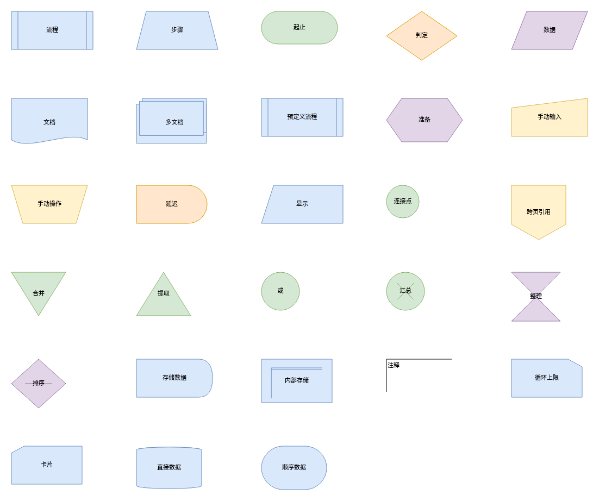

# drawio-qt

**draw.io 桌面版的原生 Qt6 / C++ 重写版本** —— 不使用 Electron、Node.js，也不嵌入 Qt WebEngine。

本项目以 [jgraph/drawio-desktop](https://github.com/jgraph/drawio-desktop)（Electron 版，v32.6.10）的
架构、文件格式和交互习惯为蓝本，用 **Qt 6 Widgets + CMake + C++20** 从零实现了一个可编辑的
draw.io 图形编辑器：自带数据模型、形状渲染、正交连线路由、撤销重做、多页面、文件读写、
PNG/SVG/PDF/HTML/XML 导出、打印以及命令行批量导出。



拖动时的对齐参考线：



连线时目标图形的锚点提示：



深色模式：



## 功能特性

- **原生绘图编辑器**：选择、框选、移动、缩放、旋转、对齐、分布、组合/取消组合、
  层级调整、复制/粘贴/复制副本、方向键微调、网格吸附、缩放与平移。
- **对齐参考线**：拖动/缩放时自动寻找其它图形的左/中/右、上/中/下对齐位置，
  显示蓝色虚线并吸附；按住 Alt 可临时关闭参考线与网格吸附。
- **原生形状库（210+ 矢量形状）**：基本形状、流程图、箭头、UML、ER、BPMN、网络、
  电气符号（电阻/电容/电感/二极管/三极管/电池/接地/逻辑门等 34 种）、平面图、
  信息图、SysML、ArchiMate、集成模式、Bootstrap、Kubernetes、界面原型、C4、DFD 等。
- **内置图标库（1910 个原生渲染的 SVG/PNG）**：Azure、Active Directory、Atlassian、
  IBM、SAP、Microsoft CAE、Allied Telesis、Cumulus、Dynamics 365、剪贴画。
- **形状浏览器**：按库分类、关键词搜索、勾选启用库；形状可拖放或双击插入。
- **连接线**：正交 / 直线 / 折线 / 实体关系路由；起点/终点箭头（实心、空心、方块、圆、菱形）；
  自由端点、固定出入点（`exitX/exitY/entryX/entryY`）与控制点；标签自动避让背景。
- **连线锚点提示**：连线过程中目标图形显示四个方向锚点，靠近时自动吸附并写入
  `exitX/exitY/entryX/entryY`，再也不用凭感觉对准；悬停图形时也会显示锚点。
- **文本编辑**：双击原位编辑，支持字体、字号、颜色、粗体/斜体/下划线、水平/垂直对齐、
  自动换行与简单 HTML（`<b>`、`<i>`、`<br>`、`<font>` 等）。
- **文件格式兼容**：直接读写 `.drawio` / `.dio` / `.xml`，兼容 draw.io 的
  **base64 + raw-deflate + percent-encoding** 压缩页面；保存时输出**未压缩、带缩进**的
  `mxGraphModel`，可直接阅读和 diff，也可与 draw.io 网页版/桌面版互相打开。
- **内嵌图数据**：PNG（`zTXt: mxGraphModel`）、PDF（`/Subject`）、SVG（`content` 属性）
  三种格式都能写入并可再次打开，与 Electron 版保持一致。
- **多文件标签页**：同一窗口打开多个文件，标签显示文件名与修改状态，支持 `Ctrl+W` 关闭。
- **多页面**：底部页面标签，新增、重命名、删除、拖动排序。
- **图层管理器**：新建/删除/重命名/上下移动/显隐/锁定图层；图层下展开对象列表，
  最上层优先显示，画布与面板选中双向同步，对象支持层内上下调整。
- **旋转**：选中显示旋转手柄，实时角度、45° 倍数吸附、Shift 15° 步进；
  旋转后的选中框、缩放手柄和连接点跟随旋转，角度写入 style 的 `rotation=…`。
- **可自定义快捷键**：帮助 → 键盘快捷键中可逐项修改、恢复默认并检测冲突，设置自动保存。
- **撤销/重做**：基于页面快照的 200 步历史，所有编辑操作（移动、样式、文本、页面设置等）均可撤销。
- **导出**：PNG / JPEG / SVG / PDF / XML / HTML；支持缩放、边距、透明背景、嵌入图数据、
  目标宽高、全部页面（PDF）、按页面尺寸导出。
- **打印**：打印与打印预览，按页面尺寸自动适配纸张，支持多页。
- **统一外观**：使用 Qt Fusion 风格，跨平台一致；支持深色/浅色配色（可跟随系统）。
- **桌面集成**：最近文件、自动保存草稿与崩溃恢复、外部修改监视、拖放打开、
  窗口几何记忆、命令行打开文件。
- **检查更新**：启动后自动检查 Release 更新清单；帮助菜单可手动检查，
  展示版本、日期与更新日志并跳转发布页。
- **命令行导出**：与 Electron 版一致的核心参数（`-x/-f/-o/-s/-b/-t/-e/-a/-p/-g/-k/-r` 等），
  可在无显示器的服务器上以 `offscreen` 模式批量转换。



内置电气符号库（原生 `QPainter` 绘制）：



流程图库：



## 快速开始

### 依赖

| 组件 | 最低版本 | 说明 |
| --- | --- | --- |
| CMake | 3.21 | 构建系统 |
| C++ 编译器 | C++20 | GCC 11+ / Clang 14+ / MSVC 2022 |
| Qt | 6.5 | Core、Gui、Widgets、Svg、PrintSupport、Xml、Test |
| zlib | 1.2 | draw.io 压缩页面与 PNG 块 |

Ubuntu / Debian / deepin：

```bash
sudo apt install build-essential cmake zlib1g-dev \
    qt6-base-dev qt6-svg-dev qt6-tools-dev libqt6printsupport6
```

Windows / macOS 请使用 Qt 官方在线安装器，并确保 `Qt6Svg`、`Qt6PrintSupport`、`Qt6Xml` 已勾选。

### 构建与运行

```bash
cmake -S . -B build -DCMAKE_BUILD_TYPE=Release
cmake --build build -j$(nproc)
./build/drawio-qt                      # 打开空白编辑器
./build/drawio-qt 图纸.drawio          # 打开文件
```

默认只构建应用程序，不编译测试。需要运行测试时：

```bash
cmake -S . -B build -DCMAKE_BUILD_TYPE=Release -DDRAWIO_QT_BUILD_TESTS=ON
cmake --build build -j$(nproc)
QT_QPA_PLATFORM=offscreen ctest --test-dir build --output-on-failure
```

安装到系统（含桌面文件、图标、示例）：

```bash
sudo cmake --install build --prefix /usr/local
```

### 命令行导出

```bash
# 导出为 PNG，2 倍缩放、10px 边距
drawio-qt -x -f png -s 2 -b 10 -o out/flow.png flow.drawio

# 导出多页 PDF，并嵌入图数据（可再次编辑）
drawio-qt -x -f pdf -a -e -o out/manual.pdf manual.drawio

# 指定页面（1 开始）与页面范围
drawio-qt -x -f pdf -p 2 -o page2.pdf flow.drawio
drawio-qt -x -f pdf -g 2..4 -o range.pdf flow.drawio

# 批量转换整个目录（递归），不覆盖已有文件
drawio-qt -x -f svg -r -k -o out/ drawings/

# 查看全部参数
drawio-qt --help
```

> 没有图形界面（无 `DISPLAY`）时，导出模式会自动使用 Qt 的 `offscreen` 平台。
> `--layout`、`--normalize`、Mermaid/VSDX 导入等依赖 Web 编辑器的功能尚未实现，会给出提示。

## 工程结构

```
drawio-qt/
├── CMakeLists.txt              # 构建、资源、安装与测试
├── src/
│   ├── core/                   # 与 UI 无关的数据层
│   │   ├── Style.*             # draw.io 样式串解析/序列化
│   │   ├── Cell.*              # 顶点/边/分组/几何
│   │   ├── Page.*              # 页面、图层、z-order、内容包围盒
│   │   ├── Document.*          # 多页面文档、读写、修改状态
│   │   ├── Compression.*       # base64 + raw deflate + percent 编码
│   │   ├── MxFileIO.*          # mxfile / mxGraphModel XML 读写
│   │   └── FileMeta.*          # PNG/PDF/SVG 内嵌 XML
│   ├── render/                 # 纯绘制逻辑（画布、打印、导出共用）
│   │   ├── ShapeRegistry.*     # 形状路径与工具箱预设
│   │   ├── ShapeRenderer.*     # 填充、描边、渐变、阴影、标签
│   │   ├── EdgeRouter.*        # 正交/直线路由与连接点
│   │   ├── EdgeRenderer.*      # 连线、箭头、连线标签
│   │   └── DiagramRenderer.*   # 页面合成、网格、页面阴影
│   ├── io/                     # 文件导出
│   │   ├── Exporter.*          # PNG/JPEG/SVG/PDF/XML 导出
│   │   └── HtmlExport.*        # 独立 HTML 查看器
│   ├── app/                    # 应用层
│   │   ├── Args.*              # 命令行参数（对应 Electron args.js）
│   │   ├── CliExport.*         # 批量导出（对应 export 模式）
│   │   └── AppSettings.*       # QSettings 配置、最近文件、草稿目录
│   ├── ui/                     # Qt Widgets 界面
│   │   ├── MainWindow.*        # 菜单、工具栏、停靠面板、文件/打印/导出
│   │   ├── DiagramView.*       # 画布：选择、拖拽、连线、撤销
│   │   ├── ShapeToolbox.*      # 形状面板（可拖放）
│   │   ├── FormatPanel.*       # 格式面板
│   │   ├── LayerPanel.*        # 图层管理器
│   │   ├── OverlayEditor.*     # 原位文本编辑
│   │   └── Dialogs.*           # 导出、页面设置、快捷键、关于
│   └── main.cpp                # 入口：CLI 分发与窗口创建
├── resources/assets/           # 图标、示例、形状库资源
├── tests/                      # QtTest 单元测试与离屏 UI 冒烟测试
├── packaging/                  # .desktop 文件
└── docs/                       # 架构、移植说明、功能对照、构建文档
```

## 文档

- [移植说明：Electron 版 → 原生 Qt6](docs/移植说明.md)
- [形状库（已覆盖范围与扩展方式）](docs/形状库.md)
- [架构设计](docs/架构设计.md)
- [功能对照表](docs/功能对照表.md)
- [构建、运行与打包](docs/构建与运行.md)

## 与 Electron 版的关系

本仓库不含 draw.io 的 Web 编辑器代码（`drawio-desktop/drawio/src/main/webapp`），
而是一个**独立的原生实现**：数据模型、XML 编解码、渲染与交互全部由 C++ 完成。
`.drawio` 文件、内嵌 PNG/PDF/SVG 的图数据与 Electron 版双向兼容。

这不是 draw.io 官方产品。draw.io / diagrams.net 是 JGraph Ltd 的商标，
本项目仅用于学习与自用移植，遵循与上游一致的 **GPL-3.0** 许可（见 [LICENSE](LICENSE)）。

## 已知限制

- draw.io 的部分库（AWS 3D、GCP、Cisco、ArchiMate 3、完整 SysML/Infographic/
  Lean/Salesforce 等）由数百到数千个 JS 绘图函数组成，尚未逐个移植；当前已覆盖
  210+ 常用矢量形状与 1910 个图标库资源，其余库可按 `docs/形状库.md` 的方式继续扩展。
- 不加载 Web 编辑器，因此没有 MathJax、Mermaid/VSDX 导入、在线模板、插件市场与云存储。
- 复杂样式按近似方式渲染：自定义 stencil、完整 CSS/HTML 标签、渐变方向、
  阴影细节等与网页版存在差异。
- 图层已支持管理面板与锁定，但尚未实现“锁定图层内局部解锁对象”等精细规则。
- 检查更新只查询并跳转发布页，不会自动下载或替换程序。
- 云厂商完整图标库（AWS/GCP/Cisco 等）未全部内置，可按 `docs/形状库.md` 继续扩展。
- 从 PNG/PDF/SVG 内嵌图数据打开时，首次保存会建议另存为 `.drawio`，不会覆盖原图。

## 参与开发

```bash
cmake -S . -B build -DCMAKE_BUILD_TYPE=Debug -DDRAWIO_QT_BUILD_TESTS=ON
cmake --build build -j$(nproc)
QT_QPA_PLATFORM=offscreen ctest --test-dir build --output-on-failure
```

代码风格：4 空格缩进、`namespace dq`、头文件使用 `#pragma once`，
核心层不得依赖 `QtWidgets`。
